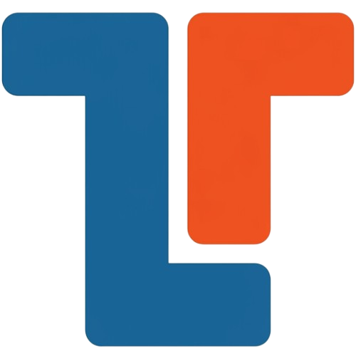

<div align="center">



# TailTheme React Lite

Open-source React admin template with TailTheme’s Free-scope shell, dashboards, and sample pages.

[Website](https://tailtheme.dev) · [Figma](https://www.figma.com/design/OjGoqhtHI9gzspszsDQ7Va/TailTheme-Web) · [Full](../tailtheme-reactjs-full)

[](LICENSE)
[](https://react.dev)
[](https://www.typescriptlang.org)
[](https://tailwindcss.com)

</div>

## Overview

**TailTheme React Lite** is a focused MIT edition of TailTheme: Vite, React 19, TypeScript, and Tailwind CSS v4, with dashboards, SaaS/Project samples, and a UI docs subset.

Auth and sample data screens are **frontend demos** — no backend or TailTheme commerce API is required to run the UI locally.

This is the public Lite edition (Free-scope pages and shell). It is **not** the separate `minimal` Home/Form starter from Full’s `create:project` exporter.

## Lite or Full?

Both editions are **free**, **MIT**, and share the same design system. They differ only in scope.

|               | **Lite** (this repo)                             | **Full**                              |
| ------------- | ------------------------------------------------ | ------------------------------------- |
| Scope         | Dashboards, SaaS/Project samples, UI docs subset | Complete demo and component reference |
| Exporter      | —                                                | `npm run create:project` in Full      |
| Shared UI PRs | Prefer Full                                      | Yes                                   |

This repository is **generated** from Full (`npm run sync:lite`). Prefer pull requests against **tailtheme-reactjs-full** for shared components and tokens.

## What's included

- App shell with sidebar, header utilities, theming, and i18n
- Overview, SaaS, and Project dashboards
- SaaS and Project sample pages (analytics, members, kanban, tasks, …)
- UI docs subset (tokens, core components, examples)
- Auth, settings, profile, landing, and pricing sample screens (UI only)
- Semantic design tokens in `src/styles/globals.css`

## Quick start

Requires **Node.js 18+** (Vite 6) and npm.

```bash
npm install
cp .env.example .env
npm run dev
```

Default app URL: [http://localhost:5173](http://localhost:5173).

Useful checks:

```bash
npm run typecheck
npm run lint
npm run build
```

## Customization

| Area                    | Location                                                           |
| ----------------------- | ------------------------------------------------------------------ |
| App name / storage keys | [`src/config.ts`](src/config.ts)                                   |
| Design tokens           | [`src/styles/globals.css`](src/styles/globals.css)                 |
| Navigation              | [`src/navigation/app-nav-tree.ts`](src/navigation/app-nav-tree.ts) |
| Routes / URLs           | [`src/routes/`](src/routes/)                                       |
| Sample fixtures         | [`src/mocks/fixtures/`](src/mocks/fixtures/)                       |

### Add a component from Full

1. Open Full and locate the file (for example `src/components/ui/calendar.tsx`).
2. Copy it and any local imports under `src/`.
3. Match dependency versions from Full’s `package.json`.
4. Import and use the component in Lite.

## Documentation

| Doc                                                | Description                                                                |
| -------------------------------------------------- | -------------------------------------------------------------------------- |
| [`DESIGN.md`](DESIGN.md)                           | Design principles                                                          |
| [`THIRD_PARTY_NOTICES.md`](THIRD_PARTY_NOTICES.md) | Third-party notices                                                        |
| Full docs                                          | See `docs/` in **tailtheme-reactjs-full** (customization, Figma, exporter) |

In-app UI pages (after `npm run dev`): under `/app/ui` — app routes, not GitHub paths.

## Figma

Design file: [TailTheme Web](https://www.figma.com/design/OjGoqhtHI9gzspszsDQ7Va/TailTheme-Web)

Foundations and reference components for TailTheme Web. Pixel-perfect parity with every screen is **not** claimed. Public view/duplicate access: confirm in Figma. Detailed notes live in Full: `docs/figma-tailtheme-web.md`.

## Scripts

| Script                            | Purpose                         |
| --------------------------------- | ------------------------------- |
| `npm run dev`                     | Start Vite dev server           |
| `npm run build`                   | Production build                |
| `npm run preview`                 | Preview production build        |
| `npm run typecheck`               | TypeScript check                |
| `npm run lint` / `lint:fix`       | ESLint                          |
| `npm run format` / `format:check` | Prettier                        |
| `npm run check`                   | typecheck + lint + format:check |

## Contributing

Shared UI, tokens, and patterns belong in **tailtheme-reactjs-full**. This Lite repo is regenerated with `npm run sync:lite` — prefer PRs against Full so changes stay regeneratable.

## Support the project

TailTheme is free and open source. If it saves you time, consider supporting its maintenance. Starring the repository, reporting bugs, improving the docs, and sharing it also help.

<!-- Maintainer: add the donation URL here when available. -->

## License

MIT — Copyright (c) 2026 **Ezway Tech**. TailTheme is the product name.

See [`LICENSE`](LICENSE). Third-party notices: [`THIRD_PARTY_NOTICES.md`](THIRD_PARTY_NOTICES.md).
